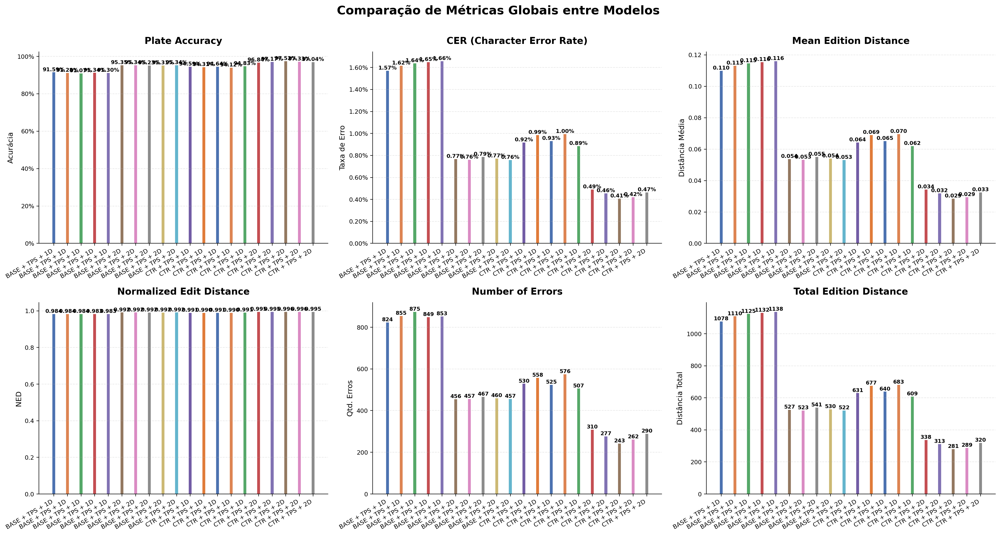
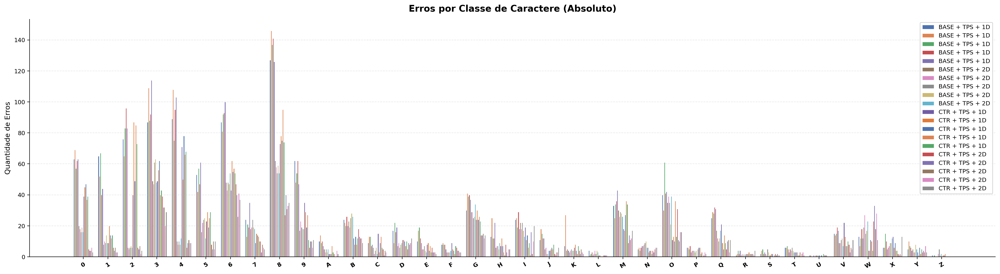
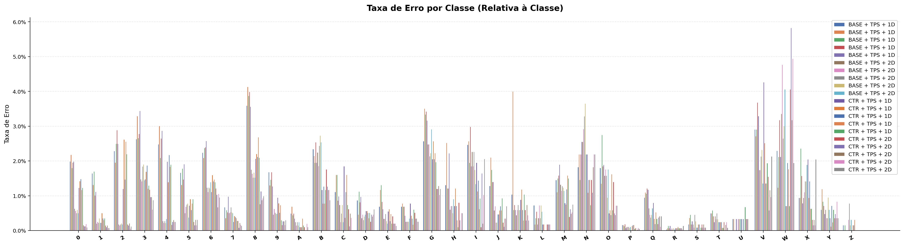
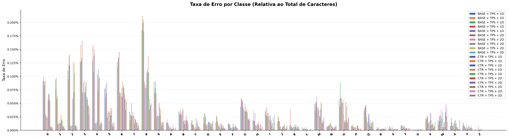
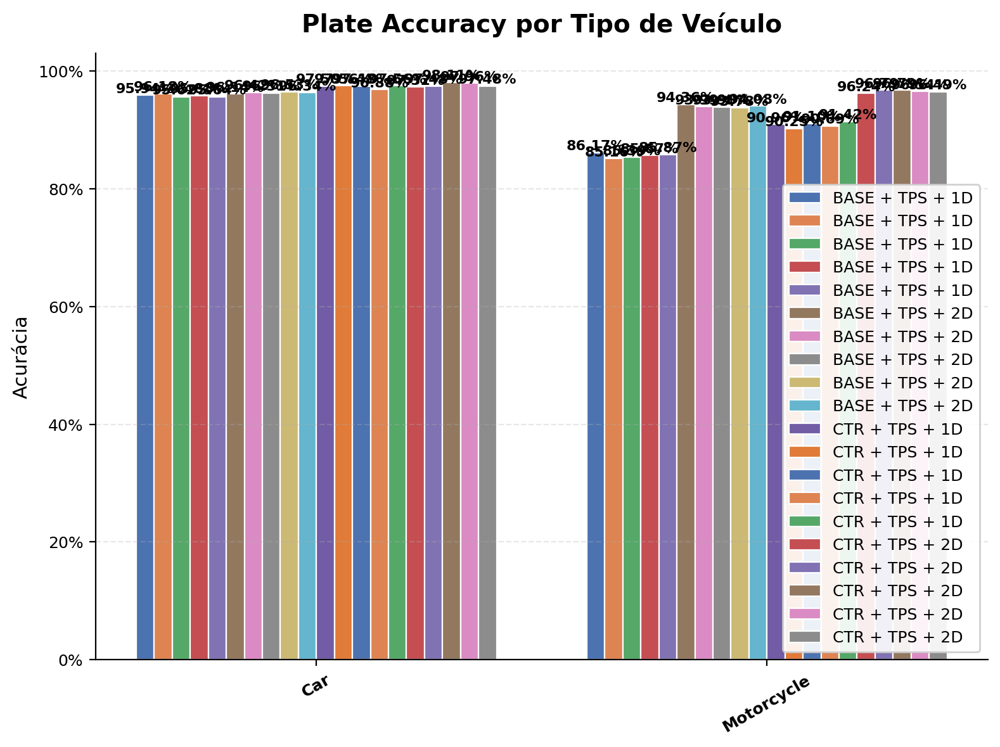
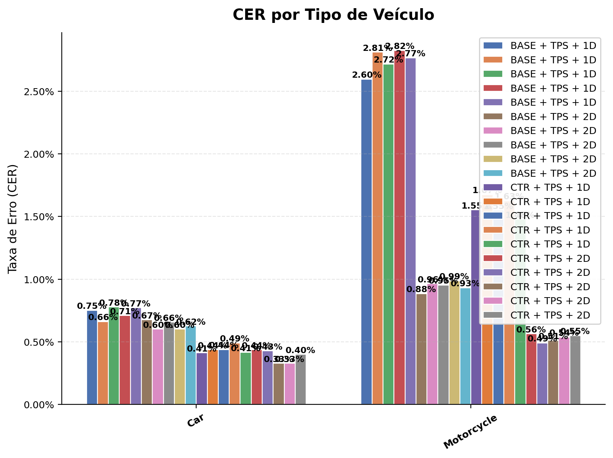
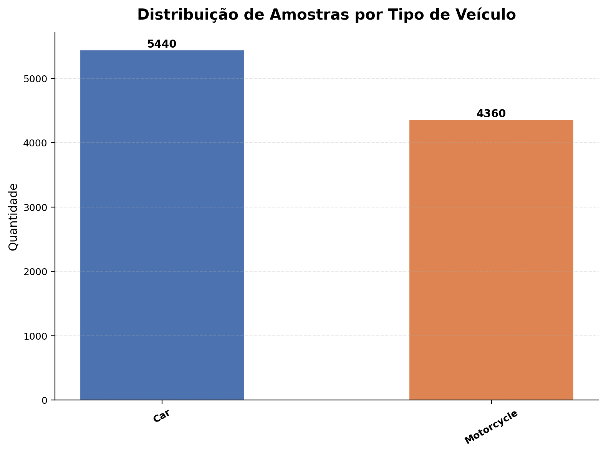

# 📊 Relatório Comparativo de Modelos

**Dataset**: `rodo_ufpr`  
**Data**: 2026-09-26 21:08:51  
**Modelos avaliados**: 20

---

## 🏷️ Modelos Avaliados

| # | Label | Run ID |
|---|-------|--------|
| 1 | **BASE + TPS + 1D [seed=1111]** | `43de0a0f21a84b7faf78721507b9fd6f` |
| 2 | **BASE + TPS + 1D [seed=2222]** | `ac7e83ab1c784beb845030bf147c98a2` |
| 3 | **BASE + TPS + 1D [seed=3333]** | `6d37c88e8502486b9fd4a44e3a952fee` |
| 4 | **BASE + TPS + 1D [seed=4444]** | `36e8b8402cc84143ba95047c6125e47b` |
| 5 | **BASE + TPS + 1D [seed=5555]** | `2a48094fcafc4086a009f75421f948bf` |
| 6 | **BASE + TPS + 2D [seed=1111]** | `2d8916b5da8a486db0bffde820e29737` |
| 7 | **BASE + TPS + 2D [seed=2222]** | `4b9c21fd78b146819d3fc0929b05bfeb` |
| 8 | **BASE + TPS + 2D [seed=3333]** | `fc48560c5b1e4eb185f47e711a51c320` |
| 9 | **BASE + TPS + 2D [seed=4444]** | `a9984d039f884dd683098fb2f4f9b734` |
| 10 | **BASE + TPS + 2D [seed=5555]** | `9e1536f5e8d64e56a421d1b2b5e8a2f2` |
| 11 | **CTR + TPS + 1D [seed=1111]** | `c48ec29f791848d2b68b621c74460c01` |
| 12 | **CTR + TPS + 1D [seed=2222]** | `c3d2d3517450464ea399f860495312f1` |
| 13 | **CTR + TPS + 1D [seed=3333]** | `681aad14bd18483b9e870d622f0eca9a` |
| 14 | **CTR + TPS + 1D [seed=4444]** | `af8d8a3a0d1845d496a44c6a8e6b42a0` |
| 15 | **CTR + TPS + 1D [seed=5555]** | `da7230b174f64e36971cca0fd48c16f7` |
| 16 | **CTR + TPS + 2D [seed=1111]** | `fae9e2edfa6d4e3481d81c0f3e802a6a` |
| 17 | **CTR + TPS + 2D [seed=2222]** | `bd753cccb03745779499c3d86149af74` |
| 18 | **CTR + TPS + 2D [seed=3333]** | `79b21e0516c34f53881954a9c46ac1d8` |
| 19 | **CTR + TPS + 2D [seed=4444]** | `97934f81212f4b2494df922d4ca3a013` |
| 20 | **CTR + TPS + 2D [seed=5555]** | `ab6a1732eadb4768a0647dcd5c242ed8` |

---

## ✅ Plate Accuracy

Proporção de placas reconhecidas corretamente (match exato).

| Modelo | Acertos | Erros | Total | Accuracy |
|--------|---------|-------|-------|----------|
| **BASE + TPS + 1D [seed=1111]** | 8976 | 824 | 9800 | **91.5918%** |
| **BASE + TPS + 1D [seed=2222]** | 8945 | 855 | 9800 | **91.2755%** |
| **BASE + TPS + 1D [seed=3333]** | 8925 | 875 | 9800 | **91.0714%** |
| **BASE + TPS + 1D [seed=4444]** | 8951 | 849 | 9800 | **91.3367%** |
| **BASE + TPS + 1D [seed=5555]** | 8947 | 853 | 9800 | **91.2959%** |
| **BASE + TPS + 2D [seed=1111]** | 9344 | 456 | 9800 | **95.3469%** |
| **BASE + TPS + 2D [seed=2222]** | 9343 | 457 | 9800 | **95.3367%** |
| **BASE + TPS + 2D [seed=3333]** | 9333 | 467 | 9800 | **95.2347%** |
| **BASE + TPS + 2D [seed=4444]** | 9340 | 460 | 9800 | **95.3061%** |
| **BASE + TPS + 2D [seed=5555]** | 9343 | 457 | 9800 | **95.3367%** |
| **CTR + TPS + 1D [seed=1111]** | 9270 | 530 | 9800 | **94.5918%** |
| **CTR + TPS + 1D [seed=2222]** | 9242 | 558 | 9800 | **94.3061%** |
| **CTR + TPS + 1D [seed=3333]** | 9275 | 525 | 9800 | **94.6429%** |
| **CTR + TPS + 1D [seed=4444]** | 9224 | 576 | 9800 | **94.1224%** |
| **CTR + TPS + 1D [seed=5555]** | 9293 | 507 | 9800 | **94.8265%** |
| **CTR + TPS + 2D [seed=1111]** | 9490 | 310 | 9800 | **96.8367%** |
| **CTR + TPS + 2D [seed=2222]** | 9523 | 277 | 9800 | **97.1735%** |
| **CTR + TPS + 2D [seed=3333]** | 9557 | 243 | 9800 | **97.5204%** |
| **CTR + TPS + 2D [seed=4444]** | 9538 | 262 | 9800 | **97.3265%** |
| **CTR + TPS + 2D [seed=5555]** | 9510 | 290 | 9800 | **97.0408%** |

> 🏆 **Melhor modelo**: CTR + TPS + 2D [seed=3333] (97.5204%)

---

## 📉 CER (Character Error Rate)

Taxa de erro a nível de caractere (edit distance / total GT chars).

| Modelo | Edit Distance Total | Total GT Chars | CER |
|--------|---------------------|----------------|-----|
| **BASE + TPS + 1D [seed=1111]** | 1078 | 68600 | **1.5714%** |
| **BASE + TPS + 1D [seed=2222]** | 1110 | 68600 | **1.6181%** |
| **BASE + TPS + 1D [seed=3333]** | 1125 | 68600 | **1.6399%** |
| **BASE + TPS + 1D [seed=4444]** | 1132 | 68600 | **1.6501%** |
| **BASE + TPS + 1D [seed=5555]** | 1138 | 68600 | **1.6589%** |
| **BASE + TPS + 2D [seed=1111]** | 527 | 68600 | **0.7682%** |
| **BASE + TPS + 2D [seed=2222]** | 523 | 68600 | **0.7624%** |
| **BASE + TPS + 2D [seed=3333]** | 541 | 68600 | **0.7886%** |
| **BASE + TPS + 2D [seed=4444]** | 530 | 68600 | **0.7726%** |
| **BASE + TPS + 2D [seed=5555]** | 522 | 68600 | **0.7609%** |
| **CTR + TPS + 1D [seed=1111]** | 631 | 68600 | **0.9198%** |
| **CTR + TPS + 1D [seed=2222]** | 677 | 68600 | **0.9869%** |
| **CTR + TPS + 1D [seed=3333]** | 640 | 68600 | **0.9329%** |
| **CTR + TPS + 1D [seed=4444]** | 683 | 68600 | **0.9956%** |
| **CTR + TPS + 1D [seed=5555]** | 609 | 68600 | **0.8878%** |
| **CTR + TPS + 2D [seed=1111]** | 338 | 68600 | **0.4927%** |
| **CTR + TPS + 2D [seed=2222]** | 313 | 68600 | **0.4563%** |
| **CTR + TPS + 2D [seed=3333]** | 281 | 68600 | **0.4096%** |
| **CTR + TPS + 2D [seed=4444]** | 289 | 68600 | **0.4213%** |
| **CTR + TPS + 2D [seed=5555]** | 320 | 68600 | **0.4665%** |

> 🏆 **Melhor modelo**: CTR + TPS + 2D [seed=3333] (CER = 0.4096%)

---

## 📏 Edition Distance

Distância de edição Levenshtein entre predição e ground truth.

| Modelo | Total | Média | Normalized ED |
|--------|-------|-------|---------------|
| **BASE + TPS + 1D [seed=1111]** | 1078 | 0.1100 | 0.9843 |
| **BASE + TPS + 1D [seed=2222]** | 1110 | 0.1133 | 0.9838 |
| **BASE + TPS + 1D [seed=3333]** | 1125 | 0.1148 | 0.9836 |
| **BASE + TPS + 1D [seed=4444]** | 1132 | 0.1155 | 0.9835 |
| **BASE + TPS + 1D [seed=5555]** | 1138 | 0.1161 | 0.9834 |
| **BASE + TPS + 2D [seed=1111]** | 527 | 0.0538 | 0.9923 |
| **BASE + TPS + 2D [seed=2222]** | 523 | 0.0534 | 0.9924 |
| **BASE + TPS + 2D [seed=3333]** | 541 | 0.0552 | 0.9921 |
| **BASE + TPS + 2D [seed=4444]** | 530 | 0.0541 | 0.9923 |
| **BASE + TPS + 2D [seed=5555]** | 522 | 0.0533 | 0.9924 |
| **CTR + TPS + 1D [seed=1111]** | 631 | 0.0644 | 0.9908 |
| **CTR + TPS + 1D [seed=2222]** | 677 | 0.0691 | 0.9901 |
| **CTR + TPS + 1D [seed=3333]** | 640 | 0.0653 | 0.9907 |
| **CTR + TPS + 1D [seed=4444]** | 683 | 0.0697 | 0.9900 |
| **CTR + TPS + 1D [seed=5555]** | 609 | 0.0621 | 0.9911 |
| **CTR + TPS + 2D [seed=1111]** | 338 | 0.0345 | 0.9951 |
| **CTR + TPS + 2D [seed=2222]** | 313 | 0.0319 | 0.9954 |
| **CTR + TPS + 2D [seed=3333]** | 281 | 0.0287 | 0.9959 |
| **CTR + TPS + 2D [seed=4444]** | 289 | 0.0295 | 0.9958 |
| **CTR + TPS + 2D [seed=5555]** | 320 | 0.0327 | 0.9953 |

> 🏆 **Melhor modelo**: CTR + TPS + 2D [seed=3333] (Média = 0.0287)

---

## ❌ Number of Errors

Número de placas com pelo menos um caractere incorreto.

| Modelo | Erros | Total | Taxa de Erro |
|--------|-------|-------|--------------|
| **BASE + TPS + 1D [seed=1111]** | 824 | 9800 | 8.4082% |
| **BASE + TPS + 1D [seed=2222]** | 855 | 9800 | 8.7245% |
| **BASE + TPS + 1D [seed=3333]** | 875 | 9800 | 8.9286% |
| **BASE + TPS + 1D [seed=4444]** | 849 | 9800 | 8.6633% |
| **BASE + TPS + 1D [seed=5555]** | 853 | 9800 | 8.7041% |
| **BASE + TPS + 2D [seed=1111]** | 456 | 9800 | 4.6531% |
| **BASE + TPS + 2D [seed=2222]** | 457 | 9800 | 4.6633% |
| **BASE + TPS + 2D [seed=3333]** | 467 | 9800 | 4.7653% |
| **BASE + TPS + 2D [seed=4444]** | 460 | 9800 | 4.6939% |
| **BASE + TPS + 2D [seed=5555]** | 457 | 9800 | 4.6633% |
| **CTR + TPS + 1D [seed=1111]** | 530 | 9800 | 5.4082% |
| **CTR + TPS + 1D [seed=2222]** | 558 | 9800 | 5.6939% |
| **CTR + TPS + 1D [seed=3333]** | 525 | 9800 | 5.3571% |
| **CTR + TPS + 1D [seed=4444]** | 576 | 9800 | 5.8776% |
| **CTR + TPS + 1D [seed=5555]** | 507 | 9800 | 5.1735% |
| **CTR + TPS + 2D [seed=1111]** | 310 | 9800 | 3.1633% |
| **CTR + TPS + 2D [seed=2222]** | 277 | 9800 | 2.8265% |
| **CTR + TPS + 2D [seed=3333]** | 243 | 9800 | 2.4796% |
| **CTR + TPS + 2D [seed=4444]** | 262 | 9800 | 2.6735% |
| **CTR + TPS + 2D [seed=5555]** | 290 | 9800 | 2.9592% |

> 🏆 **Melhor modelo**: CTR + TPS + 2D [seed=3333] (243 erros)

---

## 🔤 Erros por Classe de Caractere

Contagem absoluta de erros de reconhecimento por classe.

| Char | **BASE + TPS + 1D [seed=1111]** | **BASE + TPS + 1D [seed=2222]** | **BASE + TPS + 1D [seed=3333]** | **BASE + TPS + 1D [seed=4444]** | **BASE + TPS + 1D [seed=5555]** | **BASE + TPS + 2D [seed=1111]** | **BASE + TPS + 2D [seed=2222]** | **BASE + TPS + 2D [seed=3333]** | **BASE + TPS + 2D [seed=4444]** | **BASE + TPS + 2D [seed=5555]** | **CTR + TPS + 1D [seed=1111]** | **CTR + TPS + 1D [seed=2222]** | **CTR + TPS + 1D [seed=3333]** | **CTR + TPS + 1D [seed=4444]** | **CTR + TPS + 1D [seed=5555]** | **CTR + TPS + 2D [seed=1111]** | **CTR + TPS + 2D [seed=2222]** | **CTR + TPS + 2D [seed=3333]** | **CTR + TPS + 2D [seed=4444]** | **CTR + TPS + 2D [seed=5555]** |
|------|------|------|------|------|------|------|------|------|------|------|------|------|------|------|------|------|------|------|------|------|
| **0** | 63 | 69 | 57 | 62 | 63 | 20 | 18 | 16 | 19 | 16 | 39 | 45 | 47 | 37 | 39 | 5 | 4 | 4 | 6 | 3 |
| **1** | 65 | 52 | 67 | 40 | 44 | 8 | 10 | 9 | 14 | 9 | 9 | 20 | 14 | 12 | 14 | 6 | 4 | 6 | 3 | 3 |
| **2** | 76 | 65 | 83 | 96 | 83 | 6 | 5 | 6 | 7 | 6 | 40 | 87 | 49 | 85 | 73 | 6 | 5 | 7 | 2 | 4 |
| **3** | 87 | 109 | 88 | 92 | 114 | 49 | 47 | 61 | 63 | 48 | 49 | 56 | 62 | 40 | 43 | 39 | 32 | 32 | 20 | 29 |
| **4** | 89 | 108 | 75 | 95 | 103 | 10 | 8 | 10 | 8 | 12 | 71 | 50 | 78 | 66 | 68 | 6 | 9 | 11 | 9 | 9 |
| **5** | 53 | 42 | 57 | 47 | 61 | 16 | 22 | 24 | 25 | 12 | 23 | 29 | 19 | 25 | 29 | 8 | 5 | 10 | 5 | 10 |
| **6** | 87 | 81 | 92 | 93 | 100 | 48 | 43 | 48 | 47 | 54 | 43 | 62 | 55 | 57 | 54 | 47 | 40 | 26 | 41 | 37 |
| **7** | 24 | 13 | 21 | 19 | 35 | 18 | 19 | 24 | 19 | 18 | 9 | 15 | 14 | 13 | 10 | 10 | 3 | 8 | 6 | 5 |
| **8** | 127 | 146 | 137 | 141 | 126 | 62 | 58 | 54 | 59 | 54 | 73 | 78 | 75 | 95 | 74 | 27 | 40 | 31 | 33 | 35 |
| **9** | 62 | 48 | 54 | 62 | 47 | 17 | 23 | 19 | 18 | 18 | 35 | 29 | 19 | 27 | 11 | 6 | 10 | 10 | 6 | 11 |
| **A** | 10 | 14 | 9 | 10 | 7 | 5 | 3 | 5 | 3 | 5 | 2 | 2 | 2 | 7 | 3 | 2 | 0 | 0 | 4 | 2 |
| **B** | 24 | 22 | 20 | 26 | 20 | 23 | 19 | 25 | 28 | 26 | 12 | 8 | 13 | 8 | 12 | 18 | 13 | 12 | 12 | 9 |
| **C** | 9 | 13 | 13 | 7 | 8 | 6 | 2 | 4 | 6 | 2 | 15 | 3 | 9 | 13 | 6 | 5 | 1 | 4 | 3 | 0 |
| **D** | 17 | 9 | 22 | 16 | 19 | 7 | 9 | 6 | 8 | 9 | 11 | 11 | 10 | 7 | 10 | 5 | 9 | 8 | 9 | 12 |
| **E** | 10 | 17 | 19 | 12 | 9 | 5 | 5 | 7 | 4 | 3 | 8 | 9 | 4 | 7 | 3 | 6 | 3 | 3 | 3 | 2 |
| **F** | 8 | 9 | 8 | 8 | 5 | 3 | 3 | 3 | 3 | 4 | 9 | 5 | 4 | 2 | 7 | 6 | 4 | 4 | 3 | 3 |
| **G** | 30 | 41 | 39 | 40 | 37 | 29 | 29 | 25 | 26 | 34 | 24 | 30 | 24 | 26 | 23 | 14 | 14 | 15 | 12 | 14 |
| **H** | 13 | 25 | 12 | 12 | 22 | 6 | 7 | 7 | 5 | 9 | 7 | 12 | 7 | 3 | 1 | 8 | 3 | 0 | 5 | 5 |
| **I** | 24 | 25 | 19 | 29 | 18 | 22 | 18 | 22 | 17 | 13 | 19 | 11 | 14 | 6 | 9 | 1 | 16 | 2 | 10 | 20 |
| **J** | 11 | 18 | 15 | 12 | 12 | 5 | 6 | 2 | 2 | 4 | 4 | 5 | 6 | 5 | 8 | 2 | 1 | 3 | 3 | 6 |
| **K** | 7 | 27 | 4 | 5 | 4 | 3 | 4 | 5 | 4 | 4 | 6 | 8 | 4 | 2 | 7 | 4 | 2 | 5 | 3 | 2 |
| **L** | 4 | 1 | 2 | 3 | 1 | 2 | 4 | 2 | 4 | 3 | 1 | 1 | 0 | 0 | 0 | 1 | 1 | 1 | 1 | 0 |
| **M** | 33 | 25 | 34 | 36 | 43 | 30 | 26 | 29 | 28 | 26 | 18 | 17 | 27 | 36 | 34 | 9 | 14 | 11 | 12 | 17 |
| **N** | 5 | 6 | 4 | 6 | 7 | 7 | 8 | 9 | 10 | 6 | 6 | 3 | 4 | 4 | 2 | 4 | 3 | 5 | 6 | 6 |
| **O** | 40 | 30 | 61 | 41 | 42 | 35 | 39 | 35 | 21 | 39 | 11 | 13 | 10 | 36 | 13 | 31 | 11 | 10 | 16 | 16 |
| **P** | 6 | 6 | 5 | 7 | 3 | 4 | 4 | 4 | 3 | 4 | 0 | 5 | 6 | 6 | 2 | 3 | 0 | 1 | 3 | 2 |
| **Q** | 25 | 29 | 28 | 32 | 31 | 17 | 12 | 10 | 12 | 17 | 21 | 9 | 5 | 14 | 9 | 5 | 10 | 11 | 3 | 11 |
| **R** | 1 | 2 | 4 | 2 | 4 | 1 | 2 | 1 | 2 | 1 | 2 | 2 | 2 | 3 | 2 | 2 | 2 | 2 | 1 | 4 |
| **S** | 2 | 4 | 5 | 2 | 3 | 2 | 1 | 5 | 3 | 1 | 1 | 2 | 2 | 0 | 1 | 2 | 1 | 2 | 1 | 1 |
| **T** | 6 | 6 | 7 | 5 | 3 | 5 | 4 | 6 | 4 | 3 | 3 | 3 | 3 | 1 | 1 | 3 | 0 | 2 | 3 | 1 |
| **U** | 1 | 1 | 0 | 0 | 1 | 0 | 1 | 1 | 1 | 1 | 1 | 0 | 1 | 0 | 2 | 1 | 1 | 1 | 0 | 0 |
| **V** | 15 | 14 | 15 | 19 | 17 | 9 | 9 | 11 | 12 | 7 | 22 | 13 | 7 | 7 | 10 | 8 | 3 | 6 | 5 | 11 |
| **W** | 13 | 7 | 12 | 18 | 12 | 19 | 27 | 15 | 17 | 23 | 4 | 4 | 11 | 10 | 4 | 23 | 33 | 18 | 28 | 11 |
| **X** | 6 | 6 | 15 | 10 | 5 | 6 | 7 | 9 | 9 | 12 | 13 | 6 | 9 | 4 | 4 | 2 | 1 | 2 | 1 | 13 |
| **Y** | 5 | 10 | 7 | 6 | 4 | 5 | 3 | 3 | 8 | 5 | 3 | 1 | 6 | 2 | 5 | 3 | 4 | 3 | 7 | 3 |
| **Z** | 1 | 0 | 1 | 0 | 0 | 0 | 2 | 5 | 1 | 2 | 0 | 1 | 1 | 2 | 0 | 0 | 0 | 0 | 0 | 0 |

---

## 📊 Taxa de Erro por Classe (Relativa à Classe)

Proporção de caracteres incorretos em relação ao total de ocorrências da classe no GT.

| Char | **BASE + TPS + 1D [seed=1111]** | **BASE + TPS + 1D [seed=2222]** | **BASE + TPS + 1D [seed=3333]** | **BASE + TPS + 1D [seed=4444]** | **BASE + TPS + 1D [seed=5555]** | **BASE + TPS + 2D [seed=1111]** | **BASE + TPS + 2D [seed=2222]** | **BASE + TPS + 2D [seed=3333]** | **BASE + TPS + 2D [seed=4444]** | **BASE + TPS + 2D [seed=5555]** | **CTR + TPS + 1D [seed=1111]** | **CTR + TPS + 1D [seed=2222]** | **CTR + TPS + 1D [seed=3333]** | **CTR + TPS + 1D [seed=4444]** | **CTR + TPS + 1D [seed=5555]** | **CTR + TPS + 2D [seed=1111]** | **CTR + TPS + 2D [seed=2222]** | **CTR + TPS + 2D [seed=3333]** | **CTR + TPS + 2D [seed=4444]** | **CTR + TPS + 2D [seed=5555]** |
|------|------|------|------|------|------|------|------|------|------|------|------|------|------|------|------|------|------|------|------|------|
| **0** | 1.99% | 2.18% | 1.80% | 1.96% | 1.99% | 0.63% | 0.57% | 0.51% | 0.60% | 0.51% | 1.23% | 1.42% | 1.48% | 1.17% | 1.23% | 0.16% | 0.13% | 0.13% | 0.19% | 0.09% |
| **1** | 1.65% | 1.32% | 1.70% | 1.01% | 1.12% | 0.20% | 0.25% | 0.23% | 0.35% | 0.23% | 0.23% | 0.51% | 0.35% | 0.30% | 0.35% | 0.15% | 0.10% | 0.15% | 0.08% | 0.08% |
| **2** | 2.29% | 1.96% | 2.50% | 2.89% | 2.50% | 0.18% | 0.15% | 0.18% | 0.21% | 0.18% | 1.20% | 2.62% | 1.47% | 2.56% | 2.20% | 0.18% | 0.15% | 0.21% | 0.06% | 0.12% |
| **3** | 2.63% | 3.29% | 2.66% | 2.78% | 3.44% | 1.48% | 1.42% | 1.84% | 1.90% | 1.45% | 1.48% | 1.69% | 1.87% | 1.21% | 1.30% | 1.18% | 0.97% | 0.97% | 0.60% | 0.88% |
| **4** | 2.48% | 3.01% | 2.09% | 2.65% | 2.87% | 0.28% | 0.22% | 0.28% | 0.22% | 0.33% | 1.98% | 1.39% | 2.18% | 1.84% | 1.90% | 0.17% | 0.25% | 0.31% | 0.25% | 0.25% |
| **5** | 1.66% | 1.32% | 1.79% | 1.47% | 1.91% | 0.50% | 0.69% | 0.75% | 0.78% | 0.38% | 0.72% | 0.91% | 0.60% | 0.78% | 0.91% | 0.25% | 0.16% | 0.31% | 0.16% | 0.31% |
| **6** | 2.24% | 2.09% | 2.37% | 2.40% | 2.58% | 1.24% | 1.11% | 1.24% | 1.21% | 1.39% | 1.11% | 1.60% | 1.42% | 1.47% | 1.39% | 1.21% | 1.03% | 0.67% | 1.06% | 0.95% |
| **7** | 0.67% | 0.36% | 0.59% | 0.53% | 0.98% | 0.50% | 0.53% | 0.67% | 0.53% | 0.50% | 0.25% | 0.42% | 0.39% | 0.36% | 0.28% | 0.28% | 0.08% | 0.22% | 0.17% | 0.14% |
| **8** | 3.59% | 4.13% | 3.88% | 3.99% | 3.57% | 1.75% | 1.64% | 1.53% | 1.67% | 1.53% | 2.07% | 2.21% | 2.12% | 2.69% | 2.09% | 0.76% | 1.13% | 0.88% | 0.93% | 0.99% |
| **9** | 1.68% | 1.30% | 1.47% | 1.68% | 1.28% | 0.46% | 0.62% | 0.52% | 0.49% | 0.49% | 0.95% | 0.79% | 0.52% | 0.73% | 0.30% | 0.16% | 0.27% | 0.27% | 0.16% | 0.30% |
| **A** | 0.50% | 0.69% | 0.45% | 0.50% | 0.35% | 0.25% | 0.15% | 0.25% | 0.15% | 0.25% | 0.10% | 0.10% | 0.10% | 0.35% | 0.15% | 0.10% | 0.00% | 0.00% | 0.20% | 0.10% |
| **B** | 2.34% | 2.15% | 1.95% | 2.54% | 1.95% | 2.25% | 1.86% | 2.44% | 2.73% | 2.54% | 1.17% | 0.78% | 1.27% | 0.78% | 1.17% | 1.76% | 1.27% | 1.17% | 1.17% | 0.88% |
| **C** | 1.11% | 1.60% | 1.60% | 0.86% | 0.99% | 0.74% | 0.25% | 0.49% | 0.74% | 0.25% | 1.85% | 0.37% | 1.11% | 1.60% | 0.74% | 0.62% | 0.12% | 0.49% | 0.37% | 0.00% |
| **D** | 0.87% | 0.46% | 1.12% | 0.82% | 0.97% | 0.36% | 0.46% | 0.31% | 0.41% | 0.46% | 0.56% | 0.56% | 0.51% | 0.36% | 0.51% | 0.26% | 0.46% | 0.41% | 0.46% | 0.61% |
| **E** | 0.69% | 1.17% | 1.31% | 0.83% | 0.62% | 0.34% | 0.34% | 0.48% | 0.28% | 0.21% | 0.55% | 0.62% | 0.28% | 0.48% | 0.21% | 0.41% | 0.21% | 0.21% | 0.21% | 0.14% |
| **F** | 0.69% | 0.78% | 0.69% | 0.69% | 0.43% | 0.26% | 0.26% | 0.26% | 0.26% | 0.35% | 0.78% | 0.43% | 0.35% | 0.17% | 0.61% | 0.52% | 0.35% | 0.35% | 0.26% | 0.26% |
| **G** | 2.57% | 3.51% | 3.34% | 3.42% | 3.17% | 2.48% | 2.48% | 2.14% | 2.23% | 2.91% | 2.05% | 2.57% | 2.05% | 2.23% | 1.97% | 1.20% | 1.20% | 1.28% | 1.03% | 1.20% |
| **H** | 1.31% | 2.52% | 1.21% | 1.21% | 2.22% | 0.61% | 0.71% | 0.71% | 0.50% | 0.91% | 0.71% | 1.21% | 0.71% | 0.30% | 0.10% | 0.81% | 0.30% | 0.00% | 0.50% | 0.50% |
| **I** | 2.47% | 2.57% | 1.95% | 2.98% | 1.85% | 2.26% | 1.85% | 2.26% | 1.75% | 1.34% | 1.95% | 1.13% | 1.44% | 0.62% | 0.93% | 0.10% | 1.65% | 0.21% | 1.03% | 2.06% |
| **J** | 1.28% | 2.10% | 1.75% | 1.40% | 1.40% | 0.58% | 0.70% | 0.23% | 0.23% | 0.47% | 0.47% | 0.58% | 0.70% | 0.58% | 0.93% | 0.23% | 0.12% | 0.35% | 0.35% | 0.70% |
| **K** | 1.04% | 4.00% | 0.59% | 0.74% | 0.59% | 0.44% | 0.59% | 0.74% | 0.59% | 0.59% | 0.89% | 1.19% | 0.59% | 0.30% | 1.04% | 0.59% | 0.30% | 0.74% | 0.44% | 0.30% |
| **L** | 0.73% | 0.18% | 0.36% | 0.54% | 0.18% | 0.36% | 0.73% | 0.36% | 0.73% | 0.54% | 0.18% | 0.18% | 0.00% | 0.00% | 0.00% | 0.18% | 0.18% | 0.18% | 0.18% | 0.00% |
| **M** | 1.46% | 1.10% | 1.50% | 1.59% | 1.90% | 1.32% | 1.15% | 1.28% | 1.24% | 1.15% | 0.79% | 0.75% | 1.19% | 1.59% | 1.50% | 0.40% | 0.62% | 0.49% | 0.53% | 0.75% |
| **N** | 1.82% | 2.19% | 1.46% | 2.19% | 2.55% | 2.55% | 2.92% | 3.28% | 3.65% | 2.19% | 2.19% | 1.09% | 1.46% | 1.46% | 0.73% | 1.46% | 1.09% | 1.82% | 2.19% | 2.19% |
| **O** | 1.80% | 1.35% | 2.75% | 1.85% | 1.89% | 1.58% | 1.76% | 1.58% | 0.95% | 1.76% | 0.50% | 0.59% | 0.45% | 1.62% | 0.59% | 1.40% | 0.50% | 0.45% | 0.72% | 0.72% |
| **P** | 0.16% | 0.16% | 0.13% | 0.19% | 0.08% | 0.11% | 0.11% | 0.11% | 0.08% | 0.11% | 0.00% | 0.13% | 0.16% | 0.16% | 0.05% | 0.08% | 0.00% | 0.03% | 0.08% | 0.05% |
| **Q** | 0.95% | 1.10% | 1.06% | 1.21% | 1.18% | 0.64% | 0.46% | 0.38% | 0.46% | 0.64% | 0.80% | 0.34% | 0.19% | 0.53% | 0.34% | 0.19% | 0.38% | 0.42% | 0.11% | 0.42% |
| **R** | 0.04% | 0.07% | 0.14% | 0.07% | 0.14% | 0.04% | 0.07% | 0.04% | 0.07% | 0.04% | 0.07% | 0.07% | 0.07% | 0.11% | 0.07% | 0.07% | 0.07% | 0.07% | 0.04% | 0.14% |
| **S** | 0.18% | 0.36% | 0.45% | 0.18% | 0.27% | 0.18% | 0.09% | 0.45% | 0.27% | 0.09% | 0.09% | 0.18% | 0.18% | 0.00% | 0.09% | 0.18% | 0.09% | 0.18% | 0.09% | 0.09% |
| **T** | 0.50% | 0.50% | 0.58% | 0.41% | 0.25% | 0.41% | 0.33% | 0.50% | 0.33% | 0.25% | 0.25% | 0.25% | 0.25% | 0.08% | 0.08% | 0.25% | 0.00% | 0.17% | 0.25% | 0.08% |
| **U** | 0.34% | 0.34% | 0.00% | 0.00% | 0.34% | 0.00% | 0.34% | 0.34% | 0.34% | 0.34% | 0.34% | 0.00% | 0.34% | 0.00% | 0.68% | 0.34% | 0.34% | 0.34% | 0.00% | 0.00% |
| **V** | 2.91% | 2.71% | 2.91% | 3.68% | 3.29% | 1.74% | 1.74% | 2.13% | 2.33% | 1.36% | 4.26% | 2.52% | 1.36% | 1.36% | 1.94% | 1.55% | 0.58% | 1.16% | 0.97% | 2.13% |
| **W** | 2.30% | 1.24% | 2.12% | 3.18% | 2.12% | 3.36% | 4.77% | 2.65% | 3.00% | 4.06% | 0.71% | 0.71% | 1.94% | 1.77% | 0.71% | 4.06% | 5.83% | 3.18% | 4.95% | 1.94% |
| **X** | 0.94% | 0.94% | 2.36% | 1.57% | 0.79% | 0.94% | 1.10% | 1.42% | 1.42% | 1.89% | 2.05% | 0.94% | 1.42% | 0.63% | 0.63% | 0.31% | 0.16% | 0.31% | 0.16% | 2.05% |
| **Y** | 0.60% | 1.20% | 0.84% | 0.72% | 0.48% | 0.60% | 0.36% | 0.36% | 0.96% | 0.60% | 0.36% | 0.12% | 0.72% | 0.24% | 0.60% | 0.36% | 0.48% | 0.36% | 0.84% | 0.36% |
| **Z** | 0.16% | 0.00% | 0.16% | 0.00% | 0.00% | 0.00% | 0.31% | 0.78% | 0.16% | 0.31% | 0.00% | 0.16% | 0.16% | 0.31% | 0.00% | 0.00% | 0.00% | 0.00% | 0.00% | 0.00% |

---

## 📊 Taxa de Erro por Classe (Relativa ao Total de Caracteres)

Proporção de erros da classe em relação ao total de caracteres do GT.

| Char | **BASE + TPS + 1D [seed=1111]** | **BASE + TPS + 1D [seed=2222]** | **BASE + TPS + 1D [seed=3333]** | **BASE + TPS + 1D [seed=4444]** | **BASE + TPS + 1D [seed=5555]** | **BASE + TPS + 2D [seed=1111]** | **BASE + TPS + 2D [seed=2222]** | **BASE + TPS + 2D [seed=3333]** | **BASE + TPS + 2D [seed=4444]** | **BASE + TPS + 2D [seed=5555]** | **CTR + TPS + 1D [seed=1111]** | **CTR + TPS + 1D [seed=2222]** | **CTR + TPS + 1D [seed=3333]** | **CTR + TPS + 1D [seed=4444]** | **CTR + TPS + 1D [seed=5555]** | **CTR + TPS + 2D [seed=1111]** | **CTR + TPS + 2D [seed=2222]** | **CTR + TPS + 2D [seed=3333]** | **CTR + TPS + 2D [seed=4444]** | **CTR + TPS + 2D [seed=5555]** |
|------|------|------|------|------|------|------|------|------|------|------|------|------|------|------|------|------|------|------|------|------|
| **0** | 0.0918% | 0.1006% | 0.0831% | 0.0904% | 0.0918% | 0.0292% | 0.0262% | 0.0233% | 0.0277% | 0.0233% | 0.0569% | 0.0656% | 0.0685% | 0.0539% | 0.0569% | 0.0073% | 0.0058% | 0.0058% | 0.0087% | 0.0044% |
| **1** | 0.0948% | 0.0758% | 0.0977% | 0.0583% | 0.0641% | 0.0117% | 0.0146% | 0.0131% | 0.0204% | 0.0131% | 0.0131% | 0.0292% | 0.0204% | 0.0175% | 0.0204% | 0.0087% | 0.0058% | 0.0087% | 0.0044% | 0.0044% |
| **2** | 0.1108% | 0.0948% | 0.1210% | 0.1399% | 0.1210% | 0.0087% | 0.0073% | 0.0087% | 0.0102% | 0.0087% | 0.0583% | 0.1268% | 0.0714% | 0.1239% | 0.1064% | 0.0087% | 0.0073% | 0.0102% | 0.0029% | 0.0058% |
| **3** | 0.1268% | 0.1589% | 0.1283% | 0.1341% | 0.1662% | 0.0714% | 0.0685% | 0.0889% | 0.0918% | 0.0700% | 0.0714% | 0.0816% | 0.0904% | 0.0583% | 0.0627% | 0.0569% | 0.0466% | 0.0466% | 0.0292% | 0.0423% |
| **4** | 0.1297% | 0.1574% | 0.1093% | 0.1385% | 0.1501% | 0.0146% | 0.0117% | 0.0146% | 0.0117% | 0.0175% | 0.1035% | 0.0729% | 0.1137% | 0.0962% | 0.0991% | 0.0087% | 0.0131% | 0.0160% | 0.0131% | 0.0131% |
| **5** | 0.0773% | 0.0612% | 0.0831% | 0.0685% | 0.0889% | 0.0233% | 0.0321% | 0.0350% | 0.0364% | 0.0175% | 0.0335% | 0.0423% | 0.0277% | 0.0364% | 0.0423% | 0.0117% | 0.0073% | 0.0146% | 0.0073% | 0.0146% |
| **6** | 0.1268% | 0.1181% | 0.1341% | 0.1356% | 0.1458% | 0.0700% | 0.0627% | 0.0700% | 0.0685% | 0.0787% | 0.0627% | 0.0904% | 0.0802% | 0.0831% | 0.0787% | 0.0685% | 0.0583% | 0.0379% | 0.0598% | 0.0539% |
| **7** | 0.0350% | 0.0190% | 0.0306% | 0.0277% | 0.0510% | 0.0262% | 0.0277% | 0.0350% | 0.0277% | 0.0262% | 0.0131% | 0.0219% | 0.0204% | 0.0190% | 0.0146% | 0.0146% | 0.0044% | 0.0117% | 0.0087% | 0.0073% |
| **8** | 0.1851% | 0.2128% | 0.1997% | 0.2055% | 0.1837% | 0.0904% | 0.0845% | 0.0787% | 0.0860% | 0.0787% | 0.1064% | 0.1137% | 0.1093% | 0.1385% | 0.1079% | 0.0394% | 0.0583% | 0.0452% | 0.0481% | 0.0510% |
| **9** | 0.0904% | 0.0700% | 0.0787% | 0.0904% | 0.0685% | 0.0248% | 0.0335% | 0.0277% | 0.0262% | 0.0262% | 0.0510% | 0.0423% | 0.0277% | 0.0394% | 0.0160% | 0.0087% | 0.0146% | 0.0146% | 0.0087% | 0.0160% |
| **A** | 0.0146% | 0.0204% | 0.0131% | 0.0146% | 0.0102% | 0.0073% | 0.0044% | 0.0073% | 0.0044% | 0.0073% | 0.0029% | 0.0029% | 0.0029% | 0.0102% | 0.0044% | 0.0029% | 0.0000% | 0.0000% | 0.0058% | 0.0029% |
| **B** | 0.0350% | 0.0321% | 0.0292% | 0.0379% | 0.0292% | 0.0335% | 0.0277% | 0.0364% | 0.0408% | 0.0379% | 0.0175% | 0.0117% | 0.0190% | 0.0117% | 0.0175% | 0.0262% | 0.0190% | 0.0175% | 0.0175% | 0.0131% |
| **C** | 0.0131% | 0.0190% | 0.0190% | 0.0102% | 0.0117% | 0.0087% | 0.0029% | 0.0058% | 0.0087% | 0.0029% | 0.0219% | 0.0044% | 0.0131% | 0.0190% | 0.0087% | 0.0073% | 0.0015% | 0.0058% | 0.0044% | 0.0000% |
| **D** | 0.0248% | 0.0131% | 0.0321% | 0.0233% | 0.0277% | 0.0102% | 0.0131% | 0.0087% | 0.0117% | 0.0131% | 0.0160% | 0.0160% | 0.0146% | 0.0102% | 0.0146% | 0.0073% | 0.0131% | 0.0117% | 0.0131% | 0.0175% |
| **E** | 0.0146% | 0.0248% | 0.0277% | 0.0175% | 0.0131% | 0.0073% | 0.0073% | 0.0102% | 0.0058% | 0.0044% | 0.0117% | 0.0131% | 0.0058% | 0.0102% | 0.0044% | 0.0087% | 0.0044% | 0.0044% | 0.0044% | 0.0029% |
| **F** | 0.0117% | 0.0131% | 0.0117% | 0.0117% | 0.0073% | 0.0044% | 0.0044% | 0.0044% | 0.0044% | 0.0058% | 0.0131% | 0.0073% | 0.0058% | 0.0029% | 0.0102% | 0.0087% | 0.0058% | 0.0058% | 0.0044% | 0.0044% |
| **G** | 0.0437% | 0.0598% | 0.0569% | 0.0583% | 0.0539% | 0.0423% | 0.0423% | 0.0364% | 0.0379% | 0.0496% | 0.0350% | 0.0437% | 0.0350% | 0.0379% | 0.0335% | 0.0204% | 0.0204% | 0.0219% | 0.0175% | 0.0204% |
| **H** | 0.0190% | 0.0364% | 0.0175% | 0.0175% | 0.0321% | 0.0087% | 0.0102% | 0.0102% | 0.0073% | 0.0131% | 0.0102% | 0.0175% | 0.0102% | 0.0044% | 0.0015% | 0.0117% | 0.0044% | 0.0000% | 0.0073% | 0.0073% |
| **I** | 0.0350% | 0.0364% | 0.0277% | 0.0423% | 0.0262% | 0.0321% | 0.0262% | 0.0321% | 0.0248% | 0.0190% | 0.0277% | 0.0160% | 0.0204% | 0.0087% | 0.0131% | 0.0015% | 0.0233% | 0.0029% | 0.0146% | 0.0292% |
| **J** | 0.0160% | 0.0262% | 0.0219% | 0.0175% | 0.0175% | 0.0073% | 0.0087% | 0.0029% | 0.0029% | 0.0058% | 0.0058% | 0.0073% | 0.0087% | 0.0073% | 0.0117% | 0.0029% | 0.0015% | 0.0044% | 0.0044% | 0.0087% |
| **K** | 0.0102% | 0.0394% | 0.0058% | 0.0073% | 0.0058% | 0.0044% | 0.0058% | 0.0073% | 0.0058% | 0.0058% | 0.0087% | 0.0117% | 0.0058% | 0.0029% | 0.0102% | 0.0058% | 0.0029% | 0.0073% | 0.0044% | 0.0029% |
| **L** | 0.0058% | 0.0015% | 0.0029% | 0.0044% | 0.0015% | 0.0029% | 0.0058% | 0.0029% | 0.0058% | 0.0044% | 0.0015% | 0.0015% | 0.0000% | 0.0000% | 0.0000% | 0.0015% | 0.0015% | 0.0015% | 0.0015% | 0.0000% |
| **M** | 0.0481% | 0.0364% | 0.0496% | 0.0525% | 0.0627% | 0.0437% | 0.0379% | 0.0423% | 0.0408% | 0.0379% | 0.0262% | 0.0248% | 0.0394% | 0.0525% | 0.0496% | 0.0131% | 0.0204% | 0.0160% | 0.0175% | 0.0248% |
| **N** | 0.0073% | 0.0087% | 0.0058% | 0.0087% | 0.0102% | 0.0102% | 0.0117% | 0.0131% | 0.0146% | 0.0087% | 0.0087% | 0.0044% | 0.0058% | 0.0058% | 0.0029% | 0.0058% | 0.0044% | 0.0073% | 0.0087% | 0.0087% |
| **O** | 0.0583% | 0.0437% | 0.0889% | 0.0598% | 0.0612% | 0.0510% | 0.0569% | 0.0510% | 0.0306% | 0.0569% | 0.0160% | 0.0190% | 0.0146% | 0.0525% | 0.0190% | 0.0452% | 0.0160% | 0.0146% | 0.0233% | 0.0233% |
| **P** | 0.0087% | 0.0087% | 0.0073% | 0.0102% | 0.0044% | 0.0058% | 0.0058% | 0.0058% | 0.0044% | 0.0058% | 0.0000% | 0.0073% | 0.0087% | 0.0087% | 0.0029% | 0.0044% | 0.0000% | 0.0015% | 0.0044% | 0.0029% |
| **Q** | 0.0364% | 0.0423% | 0.0408% | 0.0466% | 0.0452% | 0.0248% | 0.0175% | 0.0146% | 0.0175% | 0.0248% | 0.0306% | 0.0131% | 0.0073% | 0.0204% | 0.0131% | 0.0073% | 0.0146% | 0.0160% | 0.0044% | 0.0160% |
| **R** | 0.0015% | 0.0029% | 0.0058% | 0.0029% | 0.0058% | 0.0015% | 0.0029% | 0.0015% | 0.0029% | 0.0015% | 0.0029% | 0.0029% | 0.0029% | 0.0044% | 0.0029% | 0.0029% | 0.0029% | 0.0029% | 0.0015% | 0.0058% |
| **S** | 0.0029% | 0.0058% | 0.0073% | 0.0029% | 0.0044% | 0.0029% | 0.0015% | 0.0073% | 0.0044% | 0.0015% | 0.0015% | 0.0029% | 0.0029% | 0.0000% | 0.0015% | 0.0029% | 0.0015% | 0.0029% | 0.0015% | 0.0015% |
| **T** | 0.0087% | 0.0087% | 0.0102% | 0.0073% | 0.0044% | 0.0073% | 0.0058% | 0.0087% | 0.0058% | 0.0044% | 0.0044% | 0.0044% | 0.0044% | 0.0015% | 0.0015% | 0.0044% | 0.0000% | 0.0029% | 0.0044% | 0.0015% |
| **U** | 0.0015% | 0.0015% | 0.0000% | 0.0000% | 0.0015% | 0.0000% | 0.0015% | 0.0015% | 0.0015% | 0.0015% | 0.0015% | 0.0000% | 0.0015% | 0.0000% | 0.0029% | 0.0015% | 0.0015% | 0.0015% | 0.0000% | 0.0000% |
| **V** | 0.0219% | 0.0204% | 0.0219% | 0.0277% | 0.0248% | 0.0131% | 0.0131% | 0.0160% | 0.0175% | 0.0102% | 0.0321% | 0.0190% | 0.0102% | 0.0102% | 0.0146% | 0.0117% | 0.0044% | 0.0087% | 0.0073% | 0.0160% |
| **W** | 0.0190% | 0.0102% | 0.0175% | 0.0262% | 0.0175% | 0.0277% | 0.0394% | 0.0219% | 0.0248% | 0.0335% | 0.0058% | 0.0058% | 0.0160% | 0.0146% | 0.0058% | 0.0335% | 0.0481% | 0.0262% | 0.0408% | 0.0160% |
| **X** | 0.0087% | 0.0087% | 0.0219% | 0.0146% | 0.0073% | 0.0087% | 0.0102% | 0.0131% | 0.0131% | 0.0175% | 0.0190% | 0.0087% | 0.0131% | 0.0058% | 0.0058% | 0.0029% | 0.0015% | 0.0029% | 0.0015% | 0.0190% |
| **Y** | 0.0073% | 0.0146% | 0.0102% | 0.0087% | 0.0058% | 0.0073% | 0.0044% | 0.0044% | 0.0117% | 0.0073% | 0.0044% | 0.0015% | 0.0087% | 0.0029% | 0.0073% | 0.0044% | 0.0058% | 0.0044% | 0.0102% | 0.0044% |
| **Z** | 0.0015% | 0.0000% | 0.0015% | 0.0000% | 0.0000% | 0.0000% | 0.0029% | 0.0073% | 0.0015% | 0.0029% | 0.0000% | 0.0015% | 0.0015% | 0.0029% | 0.0000% | 0.0000% | 0.0000% | 0.0000% | 0.0000% | 0.0000% |

---

## 🏅 Resumo Geral

| Métrica | Melhor Modelo | Valor |
|---------|---------------|-------|
| Plate Accuracy | **CTR + TPS + 2D [seed=3333]** | 97.5204% |
| CER | **CTR + TPS + 2D [seed=3333]** | 0.4096% |
| Mean Edit Distance | **CTR + TPS + 2D [seed=3333]** | 0.0287 |
| Normalized ED | **CTR + TPS + 2D [seed=3333]** | 0.9959 |
| N. Erros | **CTR + TPS + 2D [seed=3333]** | 243 |

---

## 🚗 Análise por Tipo de Veículo

Acurácia e métricas discriminadas por tipo de veículo (mapeamento: `dataset/vehicle_mapping.csv`).

### Plate Accuracy por Tipo de Veículo

| Modelo |**Car** | **Motorcycle** |
|--------|--------|--------|
| **BASE + TPS + 1D [seed=1111]** | 95.9375% (5219/5440) | 86.1697% (3757/4360) |
| **BASE + TPS + 1D [seed=2222]** | 96.1765% (5232/5440) | 85.1606% (3713/4360) |
| **BASE + TPS + 1D [seed=3333]** | 95.6250% (5202/5440) | 85.3899% (3723/4360) |
| **BASE + TPS + 1D [seed=4444]** | 95.8824% (5216/5440) | 85.6651% (3735/4360) |
| **BASE + TPS + 1D [seed=5555]** | 95.6434% (5203/5440) | 85.8716% (3744/4360) |
| **BASE + TPS + 2D [seed=1111]** | 96.1397% (5230/5440) | 94.3578% (4114/4360) |
| **BASE + TPS + 2D [seed=2222]** | 96.4154% (5245/5440) | 93.9908% (4098/4360) |
| **BASE + TPS + 2D [seed=3333]** | 96.3051% (5239/5440) | 93.8991% (4094/4360) |
| **BASE + TPS + 2D [seed=4444]** | 96.5257% (5251/5440) | 93.7844% (4089/4360) |
| **BASE + TPS + 2D [seed=5555]** | 96.3419% (5241/5440) | 94.0826% (4102/4360) |
| **CTR + TPS + 1D [seed=1111]** | 97.5000% (5304/5440) | 90.9633% (3966/4360) |
| **CTR + TPS + 1D [seed=2222]** | 97.5551% (5307/5440) | 90.2523% (3935/4360) |
| **CTR + TPS + 1D [seed=3333]** | 97.4816% (5303/5440) | 91.1009% (3972/4360) |
| **CTR + TPS + 1D [seed=4444]** | 96.8750% (5270/5440) | 90.6881% (3954/4360) |
| **CTR + TPS + 1D [seed=5555]** | 97.5551% (5307/5440) | 91.4220% (3986/4360) |
| **CTR + TPS + 2D [seed=1111]** | 97.3162% (5294/5440) | 96.2385% (4196/4360) |
| **CTR + TPS + 2D [seed=2222]** | 97.4816% (5303/5440) | 96.7890% (4220/4360) |
| **CTR + TPS + 2D [seed=3333]** | 98.1066% (5337/5440) | 96.7890% (4220/4360) |
| **CTR + TPS + 2D [seed=4444]** | 97.9596% (5329/5440) | 96.5367% (4209/4360) |
| **CTR + TPS + 2D [seed=5555]** | 97.4816% (5303/5440) | 96.4908% (4207/4360) |

### CER por Tipo de Veículo

| Modelo |**Car** | **Motorcycle** |
|--------|--------|--------|
| **BASE + TPS + 1D [seed=1111]** | 0.7511% | 2.5950% |
| **BASE + TPS + 1D [seed=2222]** | 0.6618% | 2.8113% |
| **BASE + TPS + 1D [seed=3333]** | 0.7773% | 2.7163% |
| **BASE + TPS + 1D [seed=4444]** | 0.7090% | 2.8244% |
| **BASE + TPS + 1D [seed=5555]** | 0.7721% | 2.7654% |
| **BASE + TPS + 2D [seed=1111]** | 0.6749% | 0.8847% |
| **BASE + TPS + 2D [seed=2222]** | 0.6014% | 0.9633% |
| **BASE + TPS + 2D [seed=3333]** | 0.6565% | 0.9535% |
| **BASE + TPS + 2D [seed=4444]** | 0.6014% | 0.9862% |
| **BASE + TPS + 2D [seed=5555]** | 0.6250% | 0.9305% |
| **CTR + TPS + 1D [seed=1111]** | 0.4123% | 1.5531% |
| **CTR + TPS + 1D [seed=2222]** | 0.4359% | 1.6743% |
| **CTR + TPS + 1D [seed=3333]** | 0.4386% | 1.5498% |
| **CTR + TPS + 1D [seed=4444]** | 0.4911% | 1.6252% |
| **CTR + TPS + 1D [seed=5555]** | 0.4149% | 1.4777% |
| **CTR + TPS + 2D [seed=1111]** | 0.4359% | 0.5636% |
| **CTR + TPS + 2D [seed=2222]** | 0.4280% | 0.4915% |
| **CTR + TPS + 2D [seed=3333]** | 0.3283% | 0.5111% |
| **CTR + TPS + 2D [seed=4444]** | 0.3283% | 0.5374% |
| **CTR + TPS + 2D [seed=5555]** | 0.3992% | 0.5505% |

### Detalhamento por Tipo de Veículo

#### Car

| Modelo | Acertos | Erros | Total | Accuracy | CER | MED | NED |
|--------|---------|-------|-------|----------|-----|-----|-----|
| **BASE + TPS + 1D [seed=1111]** | 5219 | 221 | 5440 | **95.9375%** | 0.7511% | 0.0526 | 0.9925 |
| **BASE + TPS + 1D [seed=2222]** | 5232 | 208 | 5440 | **96.1765%** | 0.6618% | 0.0463 | 0.9934 |
| **BASE + TPS + 1D [seed=3333]** | 5202 | 238 | 5440 | **95.6250%** | 0.7773% | 0.0544 | 0.9922 |
| **BASE + TPS + 1D [seed=4444]** | 5216 | 224 | 5440 | **95.8824%** | 0.7090% | 0.0496 | 0.9929 |
| **BASE + TPS + 1D [seed=5555]** | 5203 | 237 | 5440 | **95.6434%** | 0.7721% | 0.0540 | 0.9923 |
| **BASE + TPS + 2D [seed=1111]** | 5230 | 210 | 5440 | **96.1397%** | 0.6749% | 0.0472 | 0.9933 |
| **BASE + TPS + 2D [seed=2222]** | 5245 | 195 | 5440 | **96.4154%** | 0.6014% | 0.0421 | 0.9940 |
| **BASE + TPS + 2D [seed=3333]** | 5239 | 201 | 5440 | **96.3051%** | 0.6565% | 0.0460 | 0.9934 |
| **BASE + TPS + 2D [seed=4444]** | 5251 | 189 | 5440 | **96.5257%** | 0.6014% | 0.0421 | 0.9940 |
| **BASE + TPS + 2D [seed=5555]** | 5241 | 199 | 5440 | **96.3419%** | 0.6250% | 0.0437 | 0.9938 |
| **CTR + TPS + 1D [seed=1111]** | 5304 | 136 | 5440 | **97.5000%** | 0.4123% | 0.0289 | 0.9959 |
| **CTR + TPS + 1D [seed=2222]** | 5307 | 133 | 5440 | **97.5551%** | 0.4359% | 0.0305 | 0.9956 |
| **CTR + TPS + 1D [seed=3333]** | 5303 | 137 | 5440 | **97.4816%** | 0.4386% | 0.0307 | 0.9956 |
| **CTR + TPS + 1D [seed=4444]** | 5270 | 170 | 5440 | **96.8750%** | 0.4911% | 0.0344 | 0.9951 |
| **CTR + TPS + 1D [seed=5555]** | 5307 | 133 | 5440 | **97.5551%** | 0.4149% | 0.0290 | 0.9959 |
| **CTR + TPS + 2D [seed=1111]** | 5294 | 146 | 5440 | **97.3162%** | 0.4359% | 0.0305 | 0.9956 |
| **CTR + TPS + 2D [seed=2222]** | 5303 | 137 | 5440 | **97.4816%** | 0.4280% | 0.0300 | 0.9957 |
| **CTR + TPS + 2D [seed=3333]** | 5337 | 103 | 5440 | **98.1066%** | 0.3283% | 0.0230 | 0.9967 |
| **CTR + TPS + 2D [seed=4444]** | 5329 | 111 | 5440 | **97.9596%** | 0.3283% | 0.0230 | 0.9967 |
| **CTR + TPS + 2D [seed=5555]** | 5303 | 137 | 5440 | **97.4816%** | 0.3992% | 0.0279 | 0.9960 |

#### Motorcycle

| Modelo | Acertos | Erros | Total | Accuracy | CER | MED | NED |
|--------|---------|-------|-------|----------|-----|-----|-----|
| **BASE + TPS + 1D [seed=1111]** | 3757 | 603 | 4360 | **86.1697%** | 2.5950% | 0.1817 | 0.9740 |
| **BASE + TPS + 1D [seed=2222]** | 3713 | 647 | 4360 | **85.1606%** | 2.8113% | 0.1968 | 0.9719 |
| **BASE + TPS + 1D [seed=3333]** | 3723 | 637 | 4360 | **85.3899%** | 2.7163% | 0.1901 | 0.9728 |
| **BASE + TPS + 1D [seed=4444]** | 3735 | 625 | 4360 | **85.6651%** | 2.8244% | 0.1977 | 0.9718 |
| **BASE + TPS + 1D [seed=5555]** | 3744 | 616 | 4360 | **85.8716%** | 2.7654% | 0.1936 | 0.9723 |
| **BASE + TPS + 2D [seed=1111]** | 4114 | 246 | 4360 | **94.3578%** | 0.8847% | 0.0619 | 0.9912 |
| **BASE + TPS + 2D [seed=2222]** | 4098 | 262 | 4360 | **93.9908%** | 0.9633% | 0.0674 | 0.9904 |
| **BASE + TPS + 2D [seed=3333]** | 4094 | 266 | 4360 | **93.8991%** | 0.9535% | 0.0667 | 0.9905 |
| **BASE + TPS + 2D [seed=4444]** | 4089 | 271 | 4360 | **93.7844%** | 0.9862% | 0.0690 | 0.9901 |
| **BASE + TPS + 2D [seed=5555]** | 4102 | 258 | 4360 | **94.0826%** | 0.9305% | 0.0651 | 0.9907 |
| **CTR + TPS + 1D [seed=1111]** | 3966 | 394 | 4360 | **90.9633%** | 1.5531% | 0.1087 | 0.9845 |
| **CTR + TPS + 1D [seed=2222]** | 3935 | 425 | 4360 | **90.2523%** | 1.6743% | 0.1172 | 0.9833 |
| **CTR + TPS + 1D [seed=3333]** | 3972 | 388 | 4360 | **91.1009%** | 1.5498% | 0.1085 | 0.9845 |
| **CTR + TPS + 1D [seed=4444]** | 3954 | 406 | 4360 | **90.6881%** | 1.6252% | 0.1138 | 0.9837 |
| **CTR + TPS + 1D [seed=5555]** | 3986 | 374 | 4360 | **91.4220%** | 1.4777% | 0.1034 | 0.9852 |
| **CTR + TPS + 2D [seed=1111]** | 4196 | 164 | 4360 | **96.2385%** | 0.5636% | 0.0394 | 0.9944 |
| **CTR + TPS + 2D [seed=2222]** | 4220 | 140 | 4360 | **96.7890%** | 0.4915% | 0.0344 | 0.9951 |
| **CTR + TPS + 2D [seed=3333]** | 4220 | 140 | 4360 | **96.7890%** | 0.5111% | 0.0358 | 0.9949 |
| **CTR + TPS + 2D [seed=4444]** | 4209 | 151 | 4360 | **96.5367%** | 0.5374% | 0.0376 | 0.9946 |
| **CTR + TPS + 2D [seed=5555]** | 4207 | 153 | 4360 | **96.4908%** | 0.5505% | 0.0385 | 0.9945 |

### 🏆 Melhor Modelo por Tipo de Veículo

| Tipo | Melhor Modelo | Accuracy |
|------|---------------|----------|
| **Car** | **CTR + TPS + 2D [seed=3333]** | 98.1066% |
| **Motorcycle** | **CTR + TPS + 2D [seed=2222]** | 96.7890% |

---

## 📈 Gráficos

### Métricas Globais

### Erros por Classe (Absoluto)

### Taxa de Erro por Classe (Relativa à Classe)

### Taxa de Erro por Classe (Relativa ao Total)

### Acurácia por Tipo de Veículo

### CER por Tipo de Veículo

### Distribuição de Amostras por Tipo de Veículo

